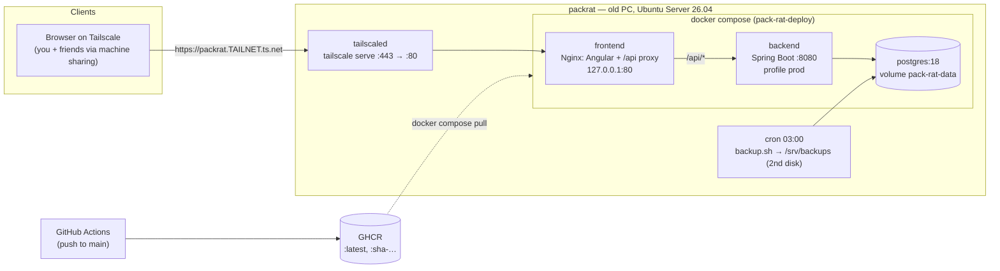

# Pack-Rat — Deployment

Pack-Rat runs on an old computer at home (`packrat`). You reach it over Tailscale, at home and from anywhere else. Nothing is exposed to the public internet. Decisions: ADR-023 to ADR-028.

## Architecture



| Container | Image | Exposed | Data |
|---|---|---|---|
| `frontend` | `ghcr.io/marcoschoch1/pack-rat-frontend:${FRONTEND_TAG}` | `127.0.0.1:80` (only `tailscale serve` reaches it) | – |
| `backend` | `ghcr.io/marcoschoch1/pack-rat-backend:${BACKEND_TAG}` | compose network only | – |
| `postgres` | `postgres:18` | compose network only | volume `pack-rat-data` → `/var/lib/postgresql` |

All three use `restart: unless-stopped`.

### URLs

- **The only URL:** `https://packrat.<tailnet>.ts.net`. HTTPS through `tailscale serve`, used by everyone, including at home, and in invite links (ADR-024). Login needs HTTPS because the auth cookie is `Secure` (ADR-019).
- The browser only ever talks to one origin. Nginx passes `/api/*` to the backend, so the frontend is built with `apiUrl: '/api'` (ADR-025).

## Repositories

| Repo | Adds for deployment |
|---|---|
| `pack-rat-backend` | `Dockerfile`, `.github/workflows/image.yml`, first-account bootstrap (ADR-027), dev `compose.yaml` pinned to `postgres:18` |
| `pack-rat-frontend` | `Dockerfile`, `nginx.conf`, `.github/workflows/image.yml`, `environment.ts` → `apiUrl: '/api'` |
| `pack-rat-deploy` (new) | `compose.yaml`, `.env.example`, `backup.sh`, README linking here |

### `nginx.conf` (frontend image)

```nginx
server {
  listen 80;
  root /usr/share/nginx/html;
  client_max_body_size 5m;            # matches spring.servlet.multipart.max-file-size; Nginx default 1m breaks uploads

  location /api/ {
    proxy_pass http://backend:8080;   # no trailing slash: keeps the /api prefix
    proxy_set_header Host $host;
    proxy_set_header X-Forwarded-Proto $scheme;
  }

  location / {
    try_files $uri $uri/ /index.html; # Angular routes survive a reload
  }
}
```

The Angular build output is `dist/frontend/browser`. Copy it into `/usr/share/nginx/html`.

### `compose.yaml` (pack-rat-deploy)

```yaml
services:
  postgres:
    image: postgres:18
    restart: unless-stopped
    environment:
      POSTGRES_DB: ${POSTGRES_DB}
      POSTGRES_USER: ${POSTGRES_USER}
      POSTGRES_PASSWORD: ${POSTGRES_PASSWORD}
    volumes:
      - pack-rat-data:/var/lib/postgresql
    healthcheck:
      test: ["CMD-SHELL", "pg_isready -U ${POSTGRES_USER} -d ${POSTGRES_DB}"]
      interval: 10s
      retries: 5

  backend:
    image: ghcr.io/marcoschoch1/pack-rat-backend:${BACKEND_TAG:-latest}
    restart: unless-stopped
    environment:
      SPRING_PROFILES_ACTIVE: prod
      DATABASE_URL: jdbc:postgresql://postgres:5432/${POSTGRES_DB}
      POSTGRES_USER: ${POSTGRES_USER}
      POSTGRES_PASSWORD: ${POSTGRES_PASSWORD}
      JWT_SECRET: ${JWT_SECRET}
      CORS_ALLOWED_ORIGINS: ${PUBLIC_URL}
      FRONTEND_URL: ${PUBLIC_URL}
      ADMIN_USERNAME: ${ADMIN_USERNAME:-}
      ADMIN_PASSWORD: ${ADMIN_PASSWORD:-}
    depends_on:
      postgres:
        condition: service_healthy

  frontend:
    image: ghcr.io/marcoschoch1/pack-rat-frontend:${FRONTEND_TAG:-latest}
    restart: unless-stopped
    ports:
      - "127.0.0.1:80:80"   # only tailscale serve reaches it (ADR-024)
    depends_on:
      - backend

volumes:
  pack-rat-data:
```

## Configuration (`.env` on the server)

The file is gitignored. `.env.example` in `pack-rat-deploy` lists the same keys with placeholder values (ADR-014).

| Variable | Value | Notes |
|---|---|---|
| `POSTGRES_DB` | `packrat` | |
| `POSTGRES_USER` | `packrat` | |
| `POSTGRES_PASSWORD` | `openssl rand -base64 32` | |
| `JWT_SECRET` | `openssl rand -base64 48` | Base64-decoded by `JwtService`, at least 256 bits |
| `PUBLIC_URL` | `https://packrat.<tailnet>.ts.net` | Invite links and CORS |
| `ADMIN_USERNAME` | your username | First account (ADR-027) |
| `ADMIN_PASSWORD` | at least 8 chars | **Delete after the first start** |
| `BACKEND_TAG` / `FRONTEND_TAG` | `latest` or `sha-<short sha>` | Rollback knob (ADR-026) |

## One-time setup

1. **Router:** add a DHCP reservation for the computer, so its LAN IP (used for SSH) stays the same. No port forwarding.
2. **OS:** install Ubuntu Server 26.04 LTS from a USB stick. Set the hostname to `packrat`, enable OpenSSH in the installer, and import your public key. Don't install any extra snaps.
3. **BIOS:** set "Restore on AC power loss" to *Power On*. On a laptop, also set `HandleLidSwitch=ignore` in `/etc/systemd/logind.conf`.
4. **SSH:** check that key login works from the Mac (`ssh packrat`). Then set `PasswordAuthentication no` in `/etc/ssh/sshd_config.d/` and restart `ssh`.
5. **Firewall:**
   ```sh
   sudo ufw default deny incoming
   sudo ufw allow from 192.168.1.0/24 to any port 22 proto tcp   # use your home subnet
   sudo ufw allow in on tailscale0
   sudo ufw enable
   ```
   Ports published by Docker bypass `ufw` (ADR-023). That's why the frontend publishes on `127.0.0.1` only.
6. **Docker:** install Docker Engine and the Compose plugin as described at <https://docs.docker.com/engine/install/ubuntu/>. Then run `sudo usermod -aG docker $USER` and log in again. Docker starts at boot by default.
7. **Tailscale:**
   ```sh
   curl -fsSL https://tailscale.com/install.sh | sh
   sudo tailscale up
   ```
   In the admin console, enable MagicDNS and HTTPS certificates. Then run `sudo tailscale serve --bg 80`. The app is now at `https://packrat.<tailnet>.ts.net` once the containers are up.
8. **Backup disk:** mount the second disk or USB drive at `/srv/backups` via `/etc/fstab` with `nofail`. Run `chown` on it so your user can write to it.
9. **Deploy repo:**
   ```sh
   git clone https://github.com/MarcoSchoch1/pack-rat-deploy.git ~/pack-rat-deploy
   cd ~/pack-rat-deploy && cp .env.example .env && nano .env   # fill in per the table above
   docker compose up -d
   docker compose logs -f backend                               # wait for startup + "created first user"
   ```
   If the GHCR packages are private, first run `docker login ghcr.io -u marcoschoch1` with a `read:packages` token.
10. **First login:** open the `ts.net` URL and log in as `ADMIN_USERNAME`. Then delete `ADMIN_PASSWORD` from `.env` and run `docker compose up -d` again.
11. **Backups:** run `crontab -e` and add
    ```
    0 3 * * * /home/<user>/pack-rat-deploy/backup.sh >> /srv/backups/backup.log 2>&1
    ```
    Run it once by hand, then test a restore (see below).
12. **Your devices:** install Tailscale on your Mac and phone and log in with the same account.
13. **Friends:** in the Tailscale admin console, share the `packrat` machine with each friend. Once they've accepted, send them an invite link from the app.

## Updating

```sh
ssh packrat
cd ~/pack-rat-deploy && git pull
./backup.sh                       # always before a deploy: ddl-auto=update may change the schema
docker compose pull && docker compose up -d
docker image prune -f
```

**Rollback:** set `BACKEND_TAG` and/or `FRONTEND_TAG` in `.env` to the last good `sha-…` tag, then run `docker compose up -d`. A schema change from the bad version isn't rolled back. If it causes problems, restore the dump taken before the deploy.

## Backup and restore

`backup.sh` (ADR-028):

```sh
#!/bin/sh
set -eu
cd "$(dirname "$0")"
. ./.env
docker compose exec -T postgres pg_dump -U "$POSTGRES_USER" -Fc "$POSTGRES_DB" > "/srv/backups/packrat-$(date +%F).dump"
find /srv/backups -name 'packrat-*.dump' -mtime +14 -delete
```

**Restore** (overwrites the current data):

```sh
docker compose stop backend
docker compose exec -T postgres pg_restore -U packrat -d packrat --clean --if-exists < /srv/backups/packrat-YYYY-MM-DD.dump
docker compose start backend
```

**Copy outside the machine:** now and then, run `scp packrat:/srv/backups/packrat-*.dump ~/Backups/pack-rat/` from the Mac.

## Known limits

- Availability is that of a home PC: a power cut, ISP outage or dead disk takes the app down (ADR-023).
- `ddl-auto=update` instead of migrations. It works for adding columns and tables, but never drops or renames anything. Switch to Flyway once a schema change needs more than that.
- There's no rate limiting or password reset yet. Acceptable while only tailnet members can reach the login page (ADR-024).
- A device without Tailscale can't use the app at all, by design (ADR-024).
